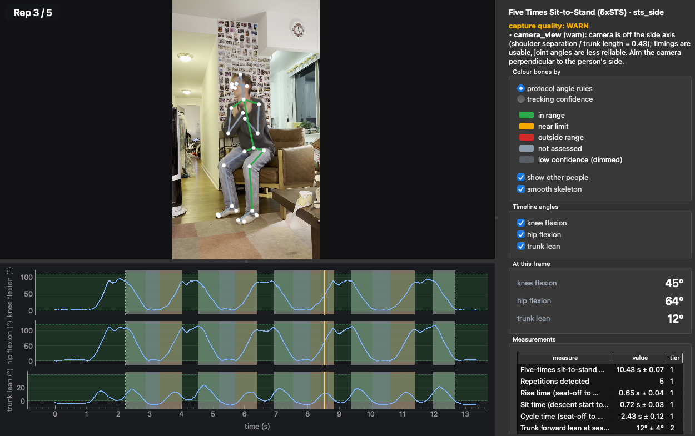

# pt-vision

Motion tracking for physical-therapy movement tests from single-phone video



## Install

**macOS**

```sh
git clone https://github.com/rkoren/pt-vision.git && cd pt-vision
./scripts/setup-mac.sh
uv run ptv demo
```


## How to use

Film from a person's **side** with the phone still, whole body in frame, and keep recording two
seconds after the last movement (details and what the quality checks look at:
[`docs/capture-guides/sts.md`](docs/capture-guides/sts.md)). Then:

```sh
uv run ptv app                                     # drop the clip in and pick which task they are performing
uv run ptv analyze clip.MOV --protocol sts_5x --age 71 --height-m 1.68 --sex f   # report only
```

Supported PT tasks: `sts_5x` (Five-Times Sit-to-Stand, with age-band reference values), `sts_30s`
(30-second chair stand) and "Pose only" for skeleton tracking of anything.

```sh
uv run ptv datasets pull uiprmd
uv run --with jupyter jupyter lab notebooks/validation.ipynb
```

Datasets info including manual OpenCap download: [`docs/datasets.md`](docs/datasets.md).

```sh
uv run ruff check . && uv run ruff format --check . && uv run mypy src
uv run pytest -m "not model"
uv run ptv models pull --mode lightweight && uv run pytest    # full suite incl. the model test
```

Pose speed on an M4 Pro CPU with the detector every 4th frame (the default): about 28 fps in
`balanced` mode and 86 fps in `lightweight` (`uv run ptv bench clip.mp4` reproduces it).

## Layout

```
src/ptvision/
  video.py     video probe, ffmpeg normalization, frame access; files.py: hashing and JSON helpers
  pose/        PoseBackend protocol, rtmlib backend, PoseTrack data (track.py), person identity
               across frames (identity.py), overlay drawing
  kinematics/  filtering, joint angles, TRC/MOT export
  clinical/    protocols (TOML), segmenters, metric registry, reference tables
  quality/     capture-quality checks
  report/      JSON report bundle + HTML rendering
  pipeline.py  the stages in order; entry points pose_only, analyze, run_pose
  viz/         shared status -> colour semantics and skeleton segments (CLI overlay and app)
  app/         PySide6 desktop viewer (optional `app` extra): pages, viewer, worker
  trials/      trial directories on disk: capture.json, runs/<id>/provenance.json
  datasets/    public-dataset manifest and pull; UI-PRMD and OpenCap readers; eval-sts, eval-video
  samples/     the bundled demo clip
  cli/         `ptv` command line
  _vendor/     BSD-3 code vendored from Pose2Sim
```

## Licensing

Public domain (Unlicense) for original code; vendored and adapted third-party code keeps its own
permissive license, listed in `NOTICE`.
