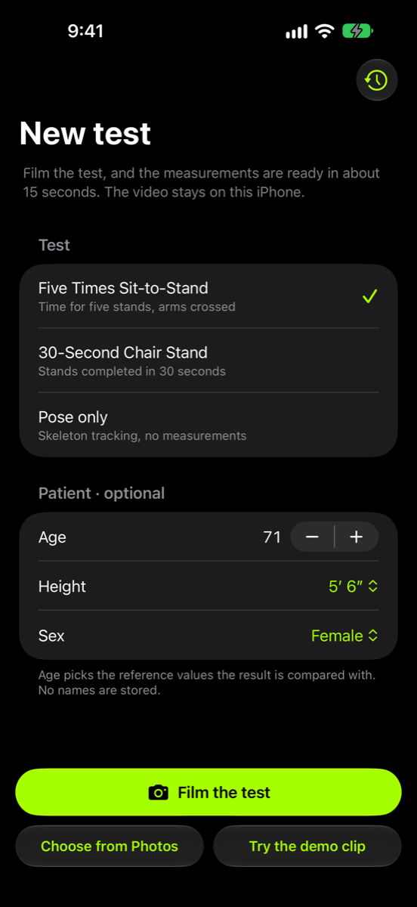
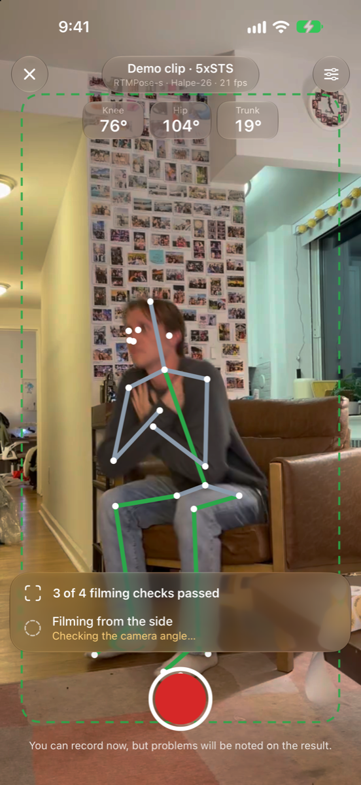
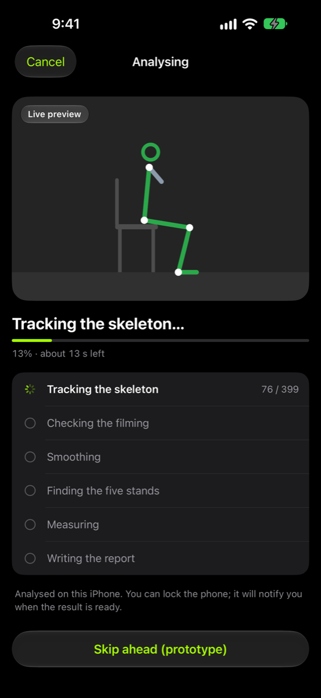
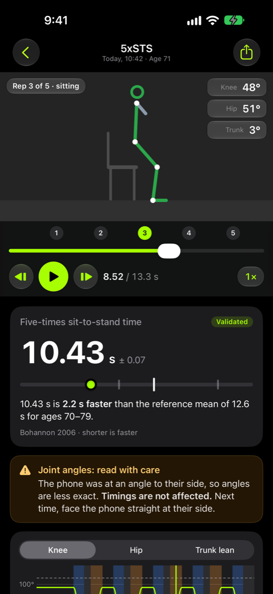
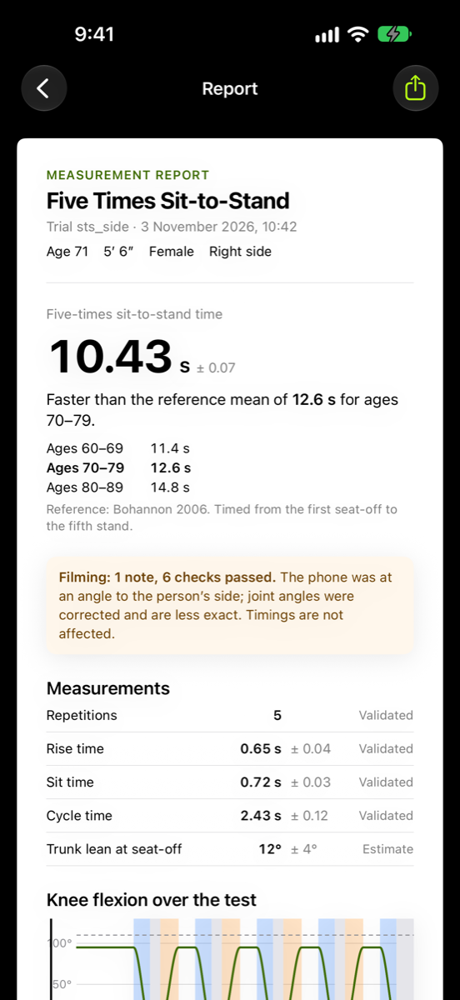

<!-- [REVIEW] New: iPhone prototype for issue #20. -->
# ptvision for iPhone (prototype)

A native SwiftUI prototype of the capture-to-report flow from issue #20:
Start → Record → Processing → Result → Report. The phone is the capture device, so the filming
checks happen while the person is being filmed, rather than after the video is uploaded.

| Start | Record | Processing | Result | Report |
| --- | --- | --- | --- | --- |
|  |  |  |  |  |

## Run it

Needs Xcode 27 and an iOS 27 simulator or device. From the repo root:

```sh
uv run python ios/scripts/fetch_assets.py
open ios/PTVision.xcodeproj
```

`fetch_assets.py` gets the `lightweight` models the way `ptv models pull` does (the URLs and
checksums in `src/ptvision/pose/models.toml`, the same cache), and copies the demo clips from this
repo. These files stay out of git because the repo ignores `*.onnx` and `*.mp4`.

The simulator runs on the demo clip, because it has no camera. To run on a device, choose your team
under Signing & Capabilities and change the bundle ID (`com.piramsingh.ptvision`) to one you can
sign.

`project.yml` is the source of truth for the Xcode project. After adding or removing files, run
`xcodegen generate` in `ios/`, with the assets fetched first so they are included.

To jump to a screen, add the launch argument `-PTVRoute record|processing|result|report`.

## What is real and what is mocked

| Part | Status |
| --- | --- |
| Pose on the record screen | Real, on device: YOLOX-tiny + RTMPose-s through ONNX Runtime, with pre- and post-processing ported from rtmlib. Apple Vision is selectable for comparison. |
| Live angles, filming checks, stand counter | Real, computed from the live pose and device motion. |
| Saving the recording | Not built. No video is written to disk. |
| Choose from Photos | Stub. It goes straight to the processing screen. |
| Processing screen | Simulated. A timer drives the progress and stage list. No pipeline runs. |
| Result and report | Mocked. They always show `Model/SampleTrial.swift`, whatever was filmed. |
| History button | Stub. It opens the sample result. |

`SampleTrial` uses the summary numbers from an `sts_side` demo run, but the per-rep times and angle
curves are synthetic, and the age, height and sex are placeholders that don't match the person in the
clip. The "Validated" tags and the wording on those screens are design proposals, not validation
claims.
